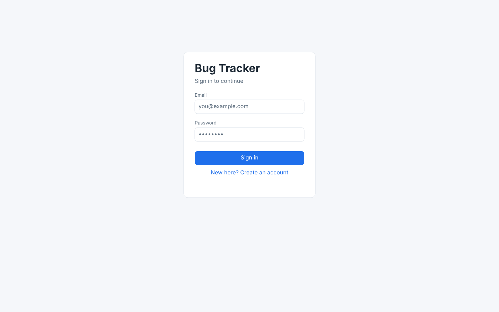
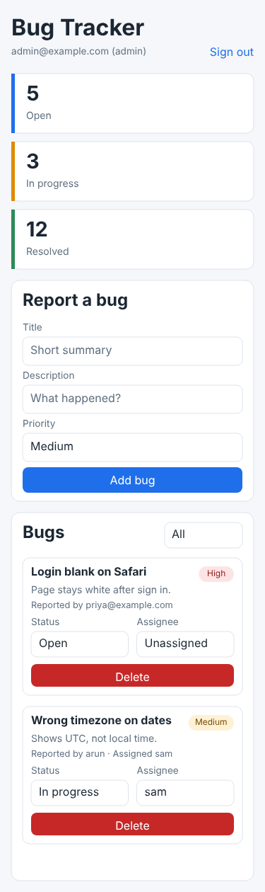
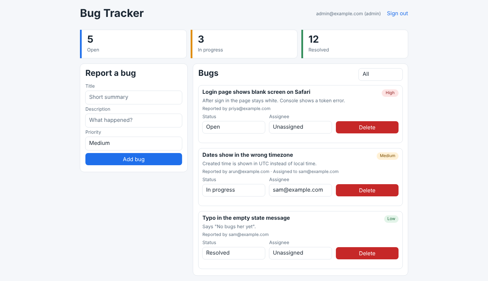
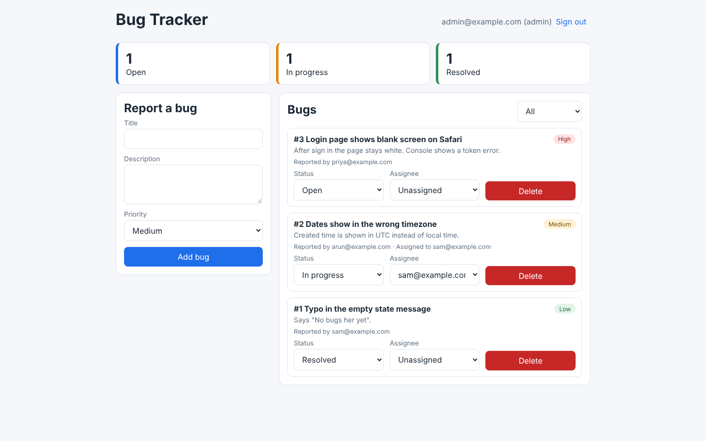

# Bug Tracker Dashboard


[](FIGMA_LINK_HERE)
[](ADD_DEMO_LINK_HERE)

> 🎨 **Designed in Figma first, then built to match the mockup** at desktop (1440 px) and mobile (375 px) widths, checked in Figma Dev Mode.


A small full-stack web app where users sign in, report bugs, and track them on a dashboard. Admins can assign and delete bugs.

**Stack:** React (JavaScript) front end, Flask REST API, SQLite (SQL) database, Python `unittest` tests.

## Run it

```bash
cd backend
pip install -r requirements.txt
python app.py
```

Open http://localhost:5000. The first account you register becomes the **admin**; later accounts are normal users. The React files load from a CDN, so you need internet access the first time the page loads.

Optional: `export SECRET_KEY="a-long-random-string"` before starting. The built-in key is for local development only.

## Run the tests

```bash
cd backend
python -m unittest -v
```

## Security and privacy

| Concern | What the code does |
| --- | --- |
| Passwords | Hashed with Werkzeug (`generate_password_hash`); never stored or returned in plain text |
| Sessions | Signed, expiring tokens (8 hours) sent as `Authorization: Bearer ...` |
| SQL injection | Every query is parameterised (`?` placeholders); covered by a test |
| Input validation | Email format, password length, title and description length, allowed status and priority values |
| Access control | Only admins assign or delete bugs; only the reporter, assignee or an admin can edit a bug |
| Account privacy | Login gives the same error for a wrong password and an unknown email |
| Brute force | 5 failed logins per client and email lock sign-in for 5 minutes (HTTP 429) |
| Headers | `X-Content-Type-Options`, `X-Frame-Options`, `Referrer-Policy`; API responses are `no-store` |
| XSS | React escapes all rendered text |

## API

All routes except register and login need `Authorization: Bearer <token>`.

| Method and path | Purpose |
| --- | --- |
| `POST /api/register` | Create an account (`email`, `password` of at least 8 characters) |
| `POST /api/login` | Returns `token`, `email`, `role` |
| `GET /api/users` | List users (used for the assignee dropdown) |
| `GET /api/bugs?status=open` | List bugs (with `reporter_email` and `assignee_email`), optionally filtered by status |
| `POST /api/bugs` | Create a bug (`title`, `description`, `priority`) |
| `PATCH /api/bugs/<id>` | Update `status`, `priority`, or (admin only) `assignee_id` |
| `DELETE /api/bugs/<id>` | Delete a bug (admin only) |
| `GET /api/stats` | Count of bugs per status |

## Design (Figma)

The full design brief (screens, components, colour and text styles, spacing) is in [`docs/FIGMA_DESIGN_SPEC.md`](docs/FIGMA_DESIGN_SPEC.md). The UI was built to match the Figma mockup at 1440 px and 375 px.

**[Open the Figma design](FIGMA_LINK_HERE)**

How I built it to match the mockup:

- Defined colour, text and spacing styles in Figma and mirrored them as CSS variables in `styles.css`
- Read exact spacing, sizes and colours in Dev Mode
- Compared the Figma frame and the running app side by side at 1440 px and 375 px, then fixed every difference

### Screens

**Sign in (desktop)**



**Dashboard, admin view (desktop)**


**Dashboard (mobile, 375 px)**



Source files (SVG, importable into Figma) are in [`docs/design/`](docs/design/).

After building: side-by-side check of the design and the running app.

| Design | Finished app |
| --- | --- |
|  |  |

## Project plan (agile)

Tasks with acceptance criteria are in [`docs/AGILE_BOARD.md`](docs/AGILE_BOARD.md). Run `bash scripts/create_issues.sh` to create them as GitHub Issues, track them on a GitHub Projects board, and commit in small steps:

- [ ] Database schema and register/login
- [ ] Bug CRUD endpoints and validation
- [ ] Role-based access and stats endpoint
- [ ] Unit tests for the API
- [ ] React sign-in screen
- [ ] React dashboard, form and list
- [ ] Match the UI to the Figma design
- [ ] Deploy a demo and add its link here

## Deploy

- **Render (easiest):** push to GitHub, then Render > New > Blueprint > choose the repo. `render.yaml` does the rest.
- **Docker:** `docker build -t bug-tracker-dashboard . && docker run -p 5000:5000 bug-tracker-dashboard`
- On the free plan the database resets when the service restarts. That is fine for a demo.

## Documentation

- [Technical design](docs/TECHNICAL_DESIGN.md): architecture, data model, security decisions, trade-offs
- [User guide](docs/USER_GUIDE.md): how to use the app
- [Figma design spec](docs/FIGMA_DESIGN_SPEC.md) and [agile board](docs/AGILE_BOARD.md)

## Ideas to extend it

- Comments on bugs, and an activity history
- Pagination and search
- Component tests with React Testing Library
- Move the token to an HTTP-only cookie
